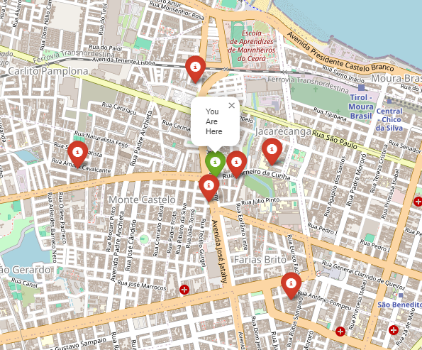

# Nearby Schools Finder | Python, MongoDB & Geospatial Analysis

## About the Project

This project demonstrates how to use **Python and MongoDB geospatial capabilities** to identify schools near a specific geographic location in Fortaleza, Ceará, Brazil.

The solution processes an educational institutions dataset, validates geographic coordinates, stores school locations in MongoDB and performs proximity searches based on user-provided coordinates and a maximum search distance.

The results are displayed on interactive maps using Folium, making it easier to visualize nearby educational institutions.

## Project Features

- **Data Extraction:** Reads educational institution records from a CSV dataset using Pandas.
- **Data Cleaning:** Handles missing values, standardizes school names and validates latitude and longitude values.
- **NoSQL Database:** Stores school information and geographic coordinates in MongoDB.
- **Geospatial Indexing:** Uses MongoDB's `2dsphere` index to support geographic queries.
- **Proximity Search:** Finds schools within a configurable distance from a given location.
- **Interactive Maps:** Uses Folium to display the user's location and nearby schools.

## Technologies

| Technology | Purpose |
|---|---|
| Python | Data processing and application logic |
| Pandas | CSV reading, transformation and data validation |
| MongoDB | NoSQL database for school records |
| PyMongo | Python integration with MongoDB |
| GeoJSON | Geographic data representation |
| Folium | Interactive map visualization |
| Geopy | Geocoding capabilities |
| Docker Compose | MongoDB container deployment |
| Jupyter Notebook | Development and execution environment |

## Architecture and Workflow

```text
Educational Institutions Dataset (CSV)
                 |
                 v
             Python
                 |
                 v
        Pandas Data Processing
                 |
                 v
       Data Cleaning and Validation
                 |
                 v
              MongoDB
                 |
                 v
         Geospatial Indexing
                 |
                 v
          Proximity Search
                 |
                 v
        Nearby Schools Results
                 |
                 v
        Folium Interactive Map
```

## Data Source

The project uses an educational institutions dataset from the municipality of Fortaleza, Brazil.

- **Source:** [Brazilian Open Data Portal – Educational Institutions](https://dados.gov.br/dados/conjuntos-dados/unidades-educacionais-sme)
- **Local dataset:** `4.4.3-unidades-educacionais-no-municipio_31.12.2023.csv`

The dataset provides school names and geographic coordinates used to populate the MongoDB collection.

## How to Run the Project

### 1. Clone the Repository

```bash
git clone https://github.com/dlinoba/schools_nearby.git

cd schools_nearby
```

### 2. Start MongoDB

Make sure Docker and Docker Compose are installed.

```bash
docker-compose up -d
```

This command starts the MongoDB container configured in `docker-compose.yml`.

MongoDB will be available at:

```text
mongodb://localhost:27017/
```

### 3. Install Python Dependencies

Install the required libraries:

```bash
pip install pandas pymongo geopy folium jupyter
```

### 4. Run the Jupyter Notebook

Start Jupyter Notebook:

```bash
jupyter notebook
```

Open `school_location.ipynb` and execute the notebook cells.

### 5. Configure Your Location

In the notebook, provide the geographic coordinates for the location you want to search around.

Example:

```python
coordinates = [-3.724725, -38.545837]
maxdistance = 0.5
```

The `maxdistance` parameter represents the search radius in kilometers.

## Map Visualization

The project generates an interactive map showing the user's location and the schools found within the configured search distance.



**Map markers:**

- **Green:** User's location.
- **Red:** Nearby educational institutions.

## Key Concepts Demonstrated

- Data ingestion and transformation with Python.
- Data quality validation.
- NoSQL database integration.
- MongoDB document modeling.
- GeoJSON geographic data representation.
- Geospatial indexing with `2dsphere`.
- Geographic proximity queries.
- Interactive geographic data visualization.

## Project Objective

The objective of this project is to demonstrate how Python and MongoDB can be integrated to transform raw educational institution data into useful geographic information.

It combines data processing, NoSQL database management, geospatial querying and interactive visualization in a practical use case.

---

**Author:** [Deyvid Linoba](https://github.com/dlinoba)
